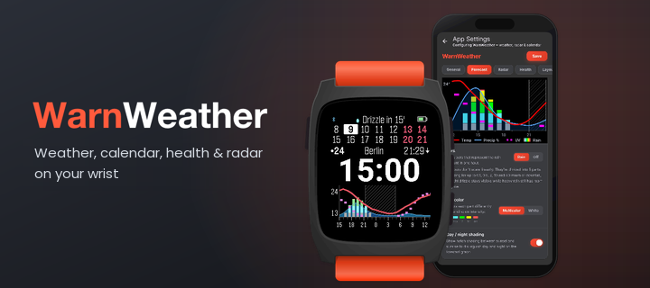
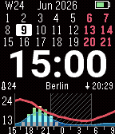
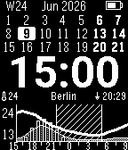
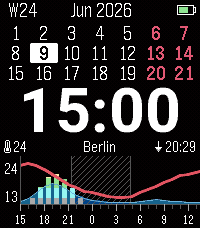

  

WarnWeather is a weather watchface for Pebble, inspired by ForecasWatch2. It shows the time, an hourly forecast graph, a calendar and status bars, and on watches that have them a rain radar and health data. Alerts stay hidden until a value reaches the level you set.

## Screenshots

| Pebble Time                                                                                       | Pebble 2 Duo                                                                                       | Pebble Time 2                                                                                      |
|---------------------------------------------------------------------------------------------------|----------------------------------------------------------------------------------------------------|----------------------------------------------------------------------------------------------------|
|  |  |  |

## Features

Features marked * depend on your watch model.

### Forecast

- Hourly forecast graph: temperature plus up to four lines*
- Rain chance and amount, cloud cover, UV index, wind, gusts, air pressure, feels-like temperature and dew point
- Lines, stripes, dots or bars, with your own colors*
- 12 to 66 hours ahead* and up to six graphs, one per screen*
- Day/night shading
- Weather from Open-Meteo, Met.no, Bright Sky (DWD), OpenWeatherMap, Tomorrow.io, Weather Underground or Yandex Weather

### Alerts*

Icons at the edge of a status bar that appear only when something needs your attention:

- Rain on its way, with a countdown
- Wind, gusts, UV index, air quality and pollen above your warn level, today or tomorrow
- Low battery, Bluetooth lost, quiet time and battery saver hours
- Your own warn and danger levels and colors for each alert

### Rain radar*

- Rain for the next 2 hours in 5-minute steps, from DWD (Germany), Met.no (Nordic countries), Rainbow.ai or Tomorrow.io (worldwide)
- Clouds, sun and lightning for the next 2 hours

### Status bars

- Weather condition with a sun or moon icon, temperature, air quality, wind, gusts, UV index, pollen, dew point, air pressure, sunrise and sunset
- Date, calendar week, city, countdown to a date
- Steps, sleep, distance, heart rate*
- Watch and phone battery
- Short forms when a bar runs out of room (Partly cloudy becomes PCLDY)
- Name your own bars and place them on any screen*

### Health*

- Steps, sleep, distance and heart rate
- 24-hour chart with steps per hour, heart rate and sleep

### Calendar

- Two or three weeks with today highlighted
- Weekend and public holiday colors for 150+ countries

### Watch

- Up to three screens, switched with a wrist flick*
- Dark, light and black & white themes, with a night theme at sunset or set hours
- 12h/24h, clock color, smooth digits*
- Battery saver hours, night backlight*

### Settings

- Live preview of every screen
- Weather tab with a 5-day forecast for your location and up to three saved places
- First-run setup with defaults for your country and watch

## Platforms

Pebble Classic, Pebble Steel, Pebble Time, Pebble Time Steel, Pebble 2, Pebble 2 Duo and Pebble Time 2.

## Installation

### Pebble appstore

- RePebble: https://apps.repebble.com/67d6f1fcdb264341b850f79a
- Rebble: https://apps.rebble.io/en_US/application/6a3645239d979d000abc99db

With the current Pebble app, install from the RePebble listing. For the Rebble app, set it up first as described at https://help.rebble.io/setup. Both stores use Rebble's backend ([blog](https://ericmigi.com/blog/re-introducing-the-pebble-appstore)) and list the same build.

### Manual install

Download [`warnweather.pbw`](https://github.com/Toasbi/WarnWeather/releases/latest/download/warnweather.pbw) from the latest release and open it with the Pebble app for [iOS](https://repebble.com/app) or [Android](https://repebble.com/app).

## Privacy and data sources

WarnWeather sends anonymous usage data: whether weather updates work, the weather provider, a rough country, app and watch versions and which settings are used. It never sends your location, the places you type, your API keys or health data. You can turn it off in Setup › Privacy & data sources › Share anonymous telemetry.

Setup › Privacy & data sources in the settings lists every data source and its license. Data from [Open-Meteo.com](https://open-meteo.com/), [MET Norway](https://www.met.no/) and the Copernicus Atmosphere Monitoring Service is used under [CC BY 4.0](https://creativecommons.org/licenses/by/4.0/).

## Developers

See [CONTRIBUTING.md](CONTRIBUTING.md) for setup and workflow.
